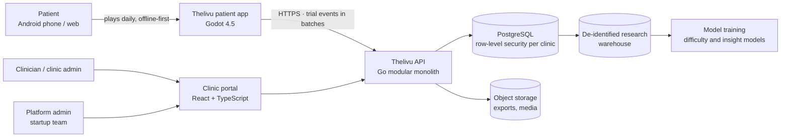
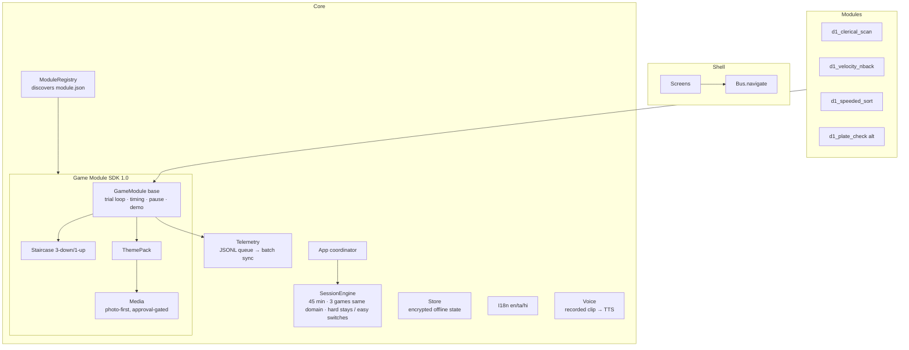

# Thelivu system architecture

| Field | Value |
| --- | --- |
| Version | 0.1 (skeleton), 21 Nov 2026 |
| Owner | Engineering (Raktim Chandra) |
| Status | Patient app built; API and portal in progress |

## 1. Context

## 2. Tenancy model (startup → clinics → patients)

| Role | Sees | Can change |
| --- | --- | --- |
| `platform_admin` (startup) | All clinics: operational data; research data only de-identified and only where consent allows | Clinics, subscriptions, module catalogue, global defaults |
| `clinic_admin` | All patients and staff of their own clinic | Staff, patients, clinic settings |
| `clinician` | Patients assigned in their clinic | Difficulty overrides, session rules, notes, alerts |
| `patient` | Only their own data | Settings, consent choices |

Clinic isolation is enforced **in the database**. Each request opens a transaction with `SET LOCAL app.clinic_id` and `app.role`, and row-level security policies filter every table by them. A bug in a handler cannot leak another clinic's rows.

## 3. Patient app

Key properties:
- **Offline-first.** Everything works without the internet, and trial events queue and sync when online.
- **Plug-in modules.** New games are folders; the registry validates them and falls back safely if one is broken.
- **Accurate timing.** Response time = monotonic microseconds since the stimulus appeared, minus paused time. Input-latency calibration per device is planned.

## 4. Data captured per trial (contract v1.0)

`event_id, session_id, module_id, module_version, theme_id, level, index, practice, outcome, correct, rt_ms, t_onset_ms, soft_goal_ms, stair_success, stimulus{…}, response{…}, recorded_at, schema_version`

These fields cover the startup's metrics:
- accuracy;
- speed and response time;
- commission and omission errors;
- daily login (R2) and session completion (R3);
- time taken (R4);
- everyday performance (R13);
- progression (R11).

## 5. Security and compliance (summary)

- **DPDP Act 2023 and Rules 2025:**
  - consent records per purpose (care, research, product improvement, model training);
  - data-principal rights handled within 90 days;
  - breach response.
- **Mental Healthcare Act 2017 §23:** confidentiality of mental-health information.
- **Encryption:** in transit with TLS 1.2+; at rest via database and disk encryption; the app's local state is encrypted with a per-install key.
- **Audit:** an audit log records every clinician read and write of patient data.
- **Regulatory:** CDSCO medical device software guidance (July 2026) to be assessed before any commercial claim of treatment.

## 6. Decisions

See [`docs/adr`](../adr).
